# Introduction {visibility="hidden"}

## About your lecturer {visibility="hidden"}

Christoph Huber

-   International Business Studies (BA), Banking & Finance (MSc), <br>Economics (PhD, 2021 University of Innsbruck)
-   Postdoctoral Researcher at WU Vienna 2021–2024

. . .

-   Assistant Professor at Aalto University School of Business, since Aug 2024

. . .

-   Research on market efficiency, decision-making under uncertainty, social and cognitive factors in (financial) decision-making, (un)ethical behavior

. . .

<br> Web: chr-huber.com   Email: christoph.huber\@aalto.fi

## Let's do some experiments!

. . .

::: columns
::: {.column width="55%"}
Principles of economic experiments:

-   application of experimental methods to study economic questions in a controlled environment

-   no deception

-   real consequences → there is a prize
:::

::: {.column width="45%"}
{width="90%"}
:::
:::

## Let's do some experiments! {visibility="uncounted"}

::: small
"Taking part in classroom experiments is a little like going to dinner at a cannibal's house. Sometimes you will be the diner, sometimes you will be part of the dinner, sometimes both.<br> It is hard to imagine that a chemist can put herself in the place of a hydrogen molecule, or that a biologist knows what it feels like to be a duck. But here we are **studying the behavior and interactions of people in economically interesting situations.** In the experiment, you will be one of these interacting economic agents, you will be able to experience the problems faced by such an agent first-hand."
:::

## Experiment 1: How the Market Works

-   You trade **shares** of one asset for **points**, over **10 periods of 2 minutes**

-   At the start you get either **3,000 points + 20 shares** or **1,000 points + 60 shares**

-   After each period, each share pays a **dividend of 0 or 10 points** (50:50 chance)

-   After period 10 the shares are **worthless**: your earnings are the points you hold at the end<br>→ your chance to win the prize is proportional to your earnings

::: notes
No written instructions: explain this slide and the next one live. Do not explain the fundamental value yet, that comes after the experiment ("Experiment 1: Fundamental value"). Endowments and dividends as in the oTree session config (endowment_high_cash = 3000 points + 20 shares, endowment_low_cash = 1000 + 60; dividend 0 or 10). Both endowments are worth 4,000 at the initial FV of 50.
:::

## Experiment 1: The Trading Screen

::: columns
::: {.column width="74%"}
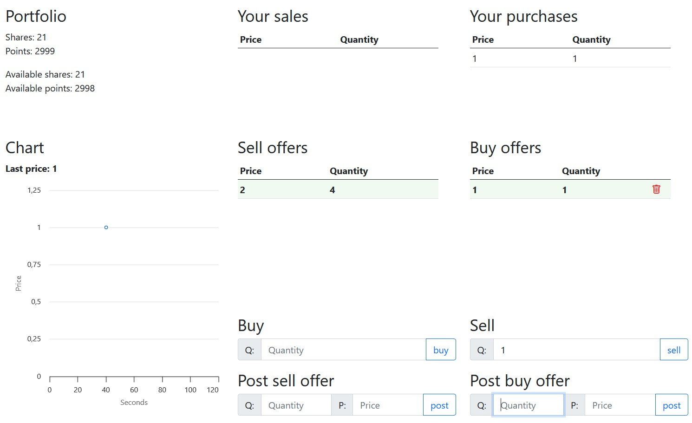{width="100%"}
:::

::: {.column .smaller width="26%"}
-   **Portfolio:** your shares and points ("available" = not tied up in your open offers)

-   **Sell / Buy offers:** what others currently offer

-   **Buy / Sell:** accept the best offer (just enter a quantity)

-   **Post sell / buy offer:** make your own offer (quantity + price)

-   **Chart:** prices of trades in this period
:::
:::

## Experiment 1 {.center style="text-align: center;"}

::: r-fit-text
[menoks.link/jvi1](https://menoks.link/jvi1)
:::

When asked for a participant label, enter your **first name**.

## Experiment 2 {.center style="text-align: center;"}

::: r-fit-text
[menoks.link/jvi2](https://menoks.link/jvi2)
:::

When asked for a participant label, enter your **first name**.

## {.title2 .center background-color="#9BD84C" background-image="material/picture_aalto_1_crop1.jpg" background-size="cover" background-position="70% center" state="is-title" visibility="uncounted"}

<!-- Second title slide, same layout as the title slide (see title-slide.html, .title2 in ch.scss) -->

```{=html}
<div class="title-block">
<h1 class="title">Bubbles and crashes in financial markets: insights from behavioral experiments</h1>
<hr class="title-rule">
<p class="author">Christoph Huber</p>
<p class="institute">Aalto University School of Business <br><br> Joint Vienna Institute: Crisis and Resilience Course</p>
<p class="date">November 2026</p>
</div>
```

## Outline

::: incremental
-   A Brief History of Speculation, Bubbles, and Financial Crises

-   The Anatomy of a Typical Crisis

-   Behavioral Insights into Bubbles and Crashes

-   From the Market to the Trader

-   Recap and a Look at Recent Bubbles
:::

## Definition of Bubbles

::: columns
::: {.column .small width="70%"}
**Definition**: Market prices are strongly above their fundamentally justified values. Consequently, markets show only very low levels of (informational) efficiency during these phases.

The term "bubble" already foreshadows that the prices of some securities will eventually decline, probably sharply.

::: fragment
**Recent examples?**
:::

::: fragment
-   Dot-com bubble (2000)
-   US real estate bubble (2002–2007)
-   Chinese stock bubble (2007)
-   Cryptocurrency bubbles (2017–2018, 2020–2022?)
-   AI / Nvidia (2023–2026)?
-   ... there are many more!
:::
:::

::: {.column width="30%"}
{height="235px"} {height="235px"}
:::
:::

## Some Examples

::: tc
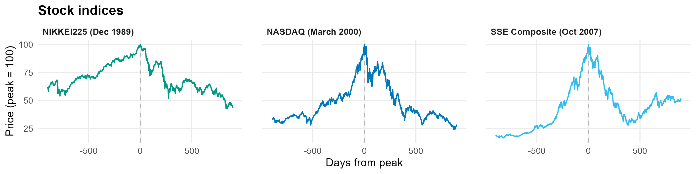{height="252px"} 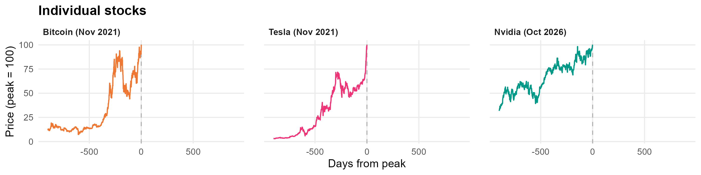{.fragment height="252px"}
:::

# A Brief History of Speculation, Bubbles, and Financial Crises {.center background-color="#9BD84C"}

## A Brief History of Speculation, Bubbles, and Financial Crises

The big ten financial bubbles:

::: smaller
1.  Dutch Tulip Bulb Bubble 1636
2.  South Sea Bubble 1720
3.  Mississippi Bubble 1720
4.  Late 1920s stock price bubble 1927–1929
5.  Surge in bank loans to Mexico and other developing countries in the 1970s
6.  Bubble in real estate and stocks in Japan 1985–1989
7.  Bubble in real estate and stocks in Finland, Norway, and Sweden, 1985–1989
8.  Bubble in real estate and stocks in Thailand, Malaysia, Indonesia, and several other Asian countries, 1992–1997
9.  Bubble in over-the-counter stocks in the US 1995–2000
10. Bubble in real estate in the US, Britain, Spain, Ireland, and Iceland, 2002–2007
:::

## Tulipmania of 1636/1637

::: columns
::: {.column .small width="55%"}
-   First stock company (VOC – Dutch East India Company) and stock exchange established in Amsterdam, Netherlands, in 1602.

-   Amsterdam Exchange great success story – within a few years Amsterdam was *the* financial center of Europe.

-   By the 1630s plenty of cash from all over Europe flooding to Amsterdam.

::: {.fragment fragment-index="2"}
→ **cheap money, lots of liquidity, leverage**
:::

-   New "citizenry" and "money nobles", rich through spice trade, with plenty of money and leisure time.

-   Tulips, recently imported from Persia, became fashionable.

::: {.fragment fragment-index="2"}
→ **a new product / new world**
:::
:::

::: {.column .tc width="45%"}
{height="190px"}

::: {.fragment fragment-index="1"}
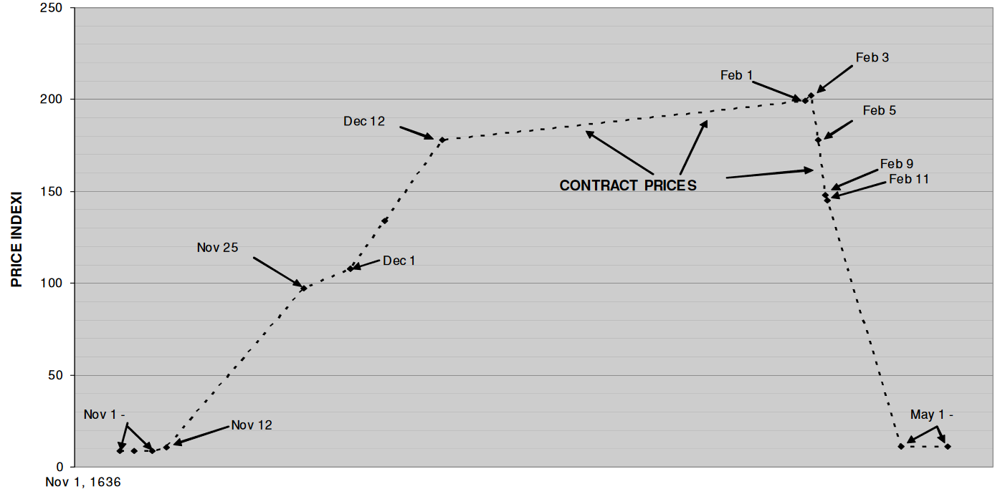{height="265px"}
:::
:::
:::

## John Law and the Mississippi Bubble of 1719–1721 {visibility="hidden"}

::: columns
::: {.column width="45%"}
<br> {width="100%"}
:::

::: {.column .smaller width="55%"}
Mississippi Company

-   business monopoly in French colonies in North America and the West Indies

John Law

-   Controller General of Finances of France

-   founded one of the first banks to develop the use of paper money: Banque Royale<br> → notes were guaranteed by the king

-   1716: Law is given a charter for the Banque Royale under which national debt was assigned to the bank in return for extraordinary privileges.<br> → authorization to issue notes, which were then used to pay government expenses and government debt<br> → national debt would be paid from revenues derived from Mississippi Company
:::
:::

## John Law and the Mississippi Bubble of 1719–1721

::: {.columns .smaller}
::: {.column width="50%"}
-   Law exaggerated the wealth of Louisiana with an effective marketing scheme, which promised success for the Mississippi Company by combining investor fervor and the wealth of its Louisiana prospects (gold) into a sustainable joint-stock trading company → wild speculation on the shares of the company in 1719

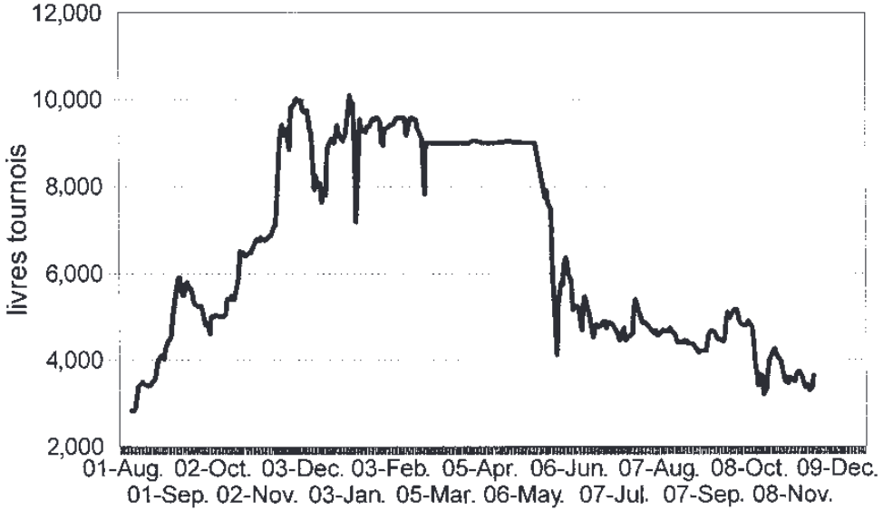{height="260px"}
:::

::: {.column width="50%"}
-   paper notes were guaranteed by the king and – in theory – backed by metal coinage

-   → *but*: number of paper notes being issued by the Banque Royale ≫ the value of the amount of metal coinage it held

-   Rapid downfall at the end of 1720: buyers of the paper notes attempted to convert their notes into specie (gold and silver) en masse, forcing the bank to stop payment on its paper notes

-   Share price fell from its peak of \~10,000 to \~500 by September 1721

"Ingredients" of the bubble:<br> → **New world, new opportunities** (Louisiana)<br> → **Cheap money and loans** (paper instead of gold, unlimited supply, loans for everybody through Banque Royale)
:::
:::

::: notes
Background slide hidden in 2026, so say it here: John Law was France's Controller General of Finances; his Banque Royale issued paper money guaranteed by the king and took over the national debt, to be repaid from the Mississippi Company, which held the trade monopoly in France's North American and West Indies colonies.
:::

# The Anatomy of a Typical Crisis {.center background-color="#9BD84C"}

## The Anatomy of a Typical Crisis

#### A simple model of financial crises developed by Hyman Minsky (1/3)

::: fragment

Key idea: *supply of credit is pro-cyclical*

::: fragment

→ "displacement", innovation, exogenous shock to the macroeconomic system

if shock is large enough, anticipated profit opportunities ↑, e.g.:

::: small
-   US in the 1920s: rapid increase in automobile production and development of highways, electrification, telephones
-   Japan in the 1980s: financial liberalization and increase in supply of money and credit
-   Asian financial crisis in 1997: discovery of "emerging market equities as a new asset class"
-   United States in the 1990s: revolution in information technologies, sharp declines in costs of communication
:::

→ firms and individuals borrow to take advantage of increased profit opportunities<br> → economic growth quickens → feedback to even greater optimism
:::
:::

## The Anatomy of a Typical Crisis

#### A simple model of financial crises developed by Hyman Minsky (2/3)

→ expansion in the supply of credit fuels the boom

::: small
-   personal credit or vendor finance
-   banks increase loans, supply of credit
:::

::: fragment

→ demand for goods and services increases → prices increase<br> → higher levels of profit attract more investment → economic growth ↑ → more investment

::: fragment

→ **"euphoria":** optimism over growth and profits, speculation on rising prices of securities or commodities

→ **"mania":** more and more households and firms join the scramble for high profits
:::
:::

::: notes
2026: merged from the former slides 2/4 and 3/4 (both kept below as hidden slides).
:::

## The Anatomy of a Typical Crisis {visibility="hidden"}

#### A simple model of financial crises developed by Hyman Minsky (2/4)

→ expansion in the supply of credit fuels the boom

::: small
-   personal credit or vendor finance
-   banks increase loans, supply of credit
:::

. . .

→ demand for goods and services increases → prices increase<br> → higher levels of profit attract more investment

. . .

Positive feedback: investment → economic growth ↑ → more investment

→ "euphoria"

## The Anatomy of a Typical Crisis {visibility="hidden"}

#### A simple model of financial crises developed by Hyman Minsky (3/4)

→ "euphoria"

::: small
-   increase in optimism over economic growth and corporate profits
-   speculation about increases in the price of securities or commodities
:::

. . .

→ "mania"

::: small
-   more and more households and firms start to participate in the scramble for high profits
:::

## The Anatomy of a Typical Crisis

#### A simple model of financial crises developed by Hyman Minsky (3/3)

Eventually, buyers become less eager to buy and sellers become more eager to sell.

::: fragment

Why? E.g.:

::: small
-   failure of a bank or a firm
-   revelation of a swindle by an investor who sought to escape distress by dishonest means
-   sharp fall in the price of a security or commodity
:::

::: fragment

→ prices decline, bankruptcies increase

As prices decline, more and more investors realize prices are unlikely to increase and that they should sell before prices decline further. This realization can come gradually or suddenly.
:::
:::

## Lessons from History

-   Financial excesses with bubbles and subsequent crashes are as old as markets themselves.

-   Specific "story" and "packaging" vary, but the basic sources are often the same: greed, cheap money and leverage, and the hope for a "new world / new economy"

. . .

-   Most scientists argue that occasional crashes are inevitable side effects of capitalism, but the degree to which this can be managed ("soft landing") is contested

. . .

Also note: authorities are often aware that something exceptional is happening, but they believe that "this time is different"

# Behavioral Insights into Bubbles and Crashes {.center background-color="#9BD84C"}

How can behavioral experiments inform our understanding of bubbles and financial crises?

## Why Do Bubbles Matter?

-   Prices no longer reflect fundamentals: no "wise crowd" → capital flows to the wrong places

-   Wealth shifts from late buyers to early sellers

-   When bubbles burst, the real economy can suffer, especially when the bubble was **financed with credit**

    ::: small
    → credit-financed (housing) bubbles are followed by much deeper recessions (Jordà, Schularick & Taylor, 2015)
    :::

. . .

→ We need to understand how bubbles form and how to prevent them, but they are hard to study ...

::: notes
2026: replaces "Implications of Bubbles" (kept hidden below). Jordà, Ò., Schularick, M. & Taylor, A. M. (2015), "Leveraged bubbles", Journal of Monetary Economics 76: bubbles financed with credit, especially housing, are followed by deeper recessions and slower recoveries; equity bubbles without much credit (e.g. dot-com) do much less damage. Ties to the Minsky slides and to "more cash and credit → larger bubbles" (Weitzel) on the policymakers slide.
:::

## Why Are Bubbles Hard to Study?

::: columns
::: {.column width="70%"}
Recall: in a bubble, prices are strongly above their **fundamental values (FV)**.

::: fragment
But in real markets:

-   What *is* the fundamental value? We cannot observe it.
-   How large must the deviation be to call it a "bubble"?
:::
:::

::: {.column width="30%"}
{height="235px"} {height="235px"}
:::
:::

## Implications of Bubbles {visibility="hidden"}

::: small
-   Market prices do not reflect fundamental values – no "wise crowd"!

-   Reallocation of wealth among the market participants

-   A recession in the real economy is mainly following bubbles and their burst.

-   Therefore, it is crucial to know more about how bubbles form and how they can be prevented
:::

::: notes
2026: the two sub-bullets on why this is hard with field data (few bubbles, unobservable fundamentals) and how experiments help moved to the next slide, which makes that case.
:::

## Why Experimental Finance? {visibility="hidden"}

Why do we need even more data? Isn't there enough real data, especially in finance?

. . .

-   "Real" data typically includes many unobservable events that had an influence on market data (prices).

-   E.g., we normally cannot know investors' expectations.

-   Theory of financial markets (and economics of uncertainty) is built on expectations.

-   We thus need data on expectations to distinguish among competing theories.

## Why Experimental Finance?

Real market data can't show us investors' expectations or the fundamental values, so we can't tell competing theories apart.

-   In a controlled experiment, the researcher can affect the expectations and knows the underlying parameters.

-   With this knowledge, we know for example the assets' fundamental values and also other predictions of alternative theories.

-   We can therefore conduct powerful tests of theories which were not possible from the field data (because we know little about the parameters and expectations that generate the field data from the stock exchanges).

-   We can also test policy levers directly (e.g., short-selling bans, liquidity injections).

. . .

→ *control*

## Experiment 1

#### Market setup

-   Experimental asset market over 10 periods of 120s

    -   About 15 traders per market (2 markets)

    -   Asset is worthless at the end of the experiment

    -   Dividend payments 0 or 10<br> → Fundamental value of the asset is decreasing over time

## Experiment 1

#### Fundamental value

::: columns
::: {.column width="40%"}
-   Asset is worthless at the end of the experiment

-   Fundamental value (FV) is only determined by expected *remaining dividends*

-   Dividend each period: 0 or 10 with equal probability<br>→ on average **5**
:::

::: {.column .fv-table width="60%"}
| Period | Remaining<br>dividends | Average<br>dividend | FV |
|:---:|:---:|:---:|:---:|
| 1 | 10 | × 5 | = **50** |
| 2 | 9 | × 5 | = **45** |
| 3 | 8 | × 5 | = **40** |
| 4 | 7 | × 5 | = **35** |
| 5 | 6 | × 5 | = **30** |
| 6 | 5 | × 5 | = **25** |
| 7 | 4 | × 5 | = **20** |
| 8 | 3 | × 5 | = **15** |
| 9 | 2 | × 5 | = **10** |
| 10 | 1 | × 5 | = **5** |
:::
:::

## Experiment 1

#### Your data

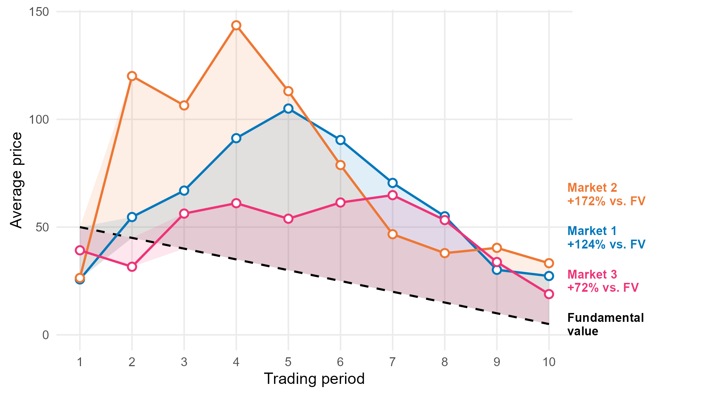{fig-align="center" height="450px"}

::: small
Typical bubble pattern with crash towards the end
:::

::: notes
Percentages in the chart are the relative deviation (RD): average over periods of (price − FV) / average FV.


:::

## Experiment 1

#### Your earnings



## Experiment 1

#### Evidence from 166 markets with 1,544 participants

4 conditions, same results: consistent bubble-crash pattern

::: tc
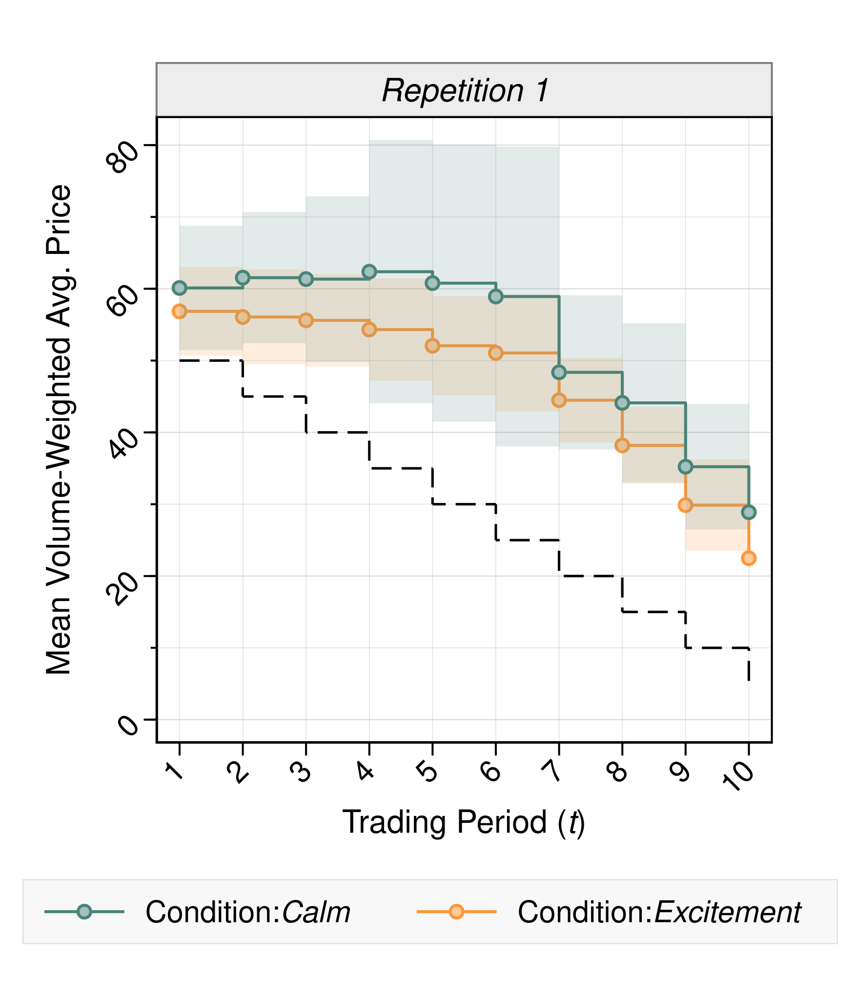{height="440px"}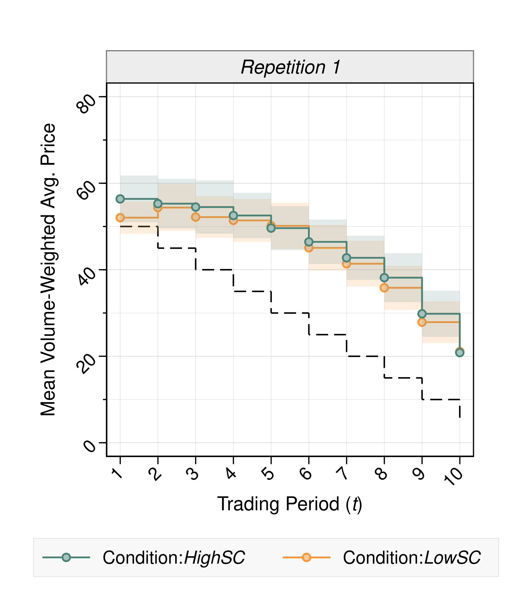{height="440px" style="margin-left: 16px;"}
:::

## Experiment 1

#### Evidence from 166 markets with 1,544 participants (1)

Experience reduces bubbles

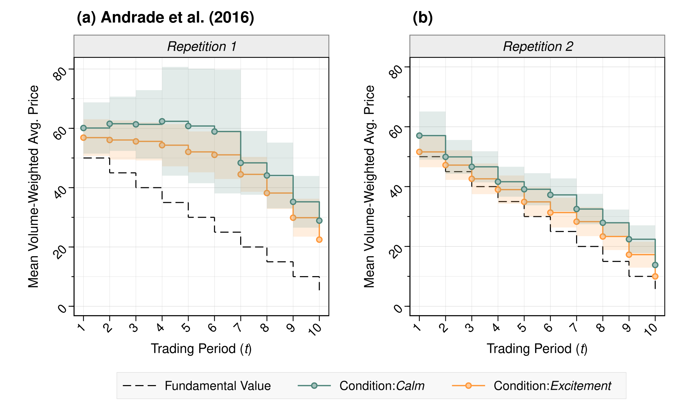{fig-align="center" height="440px"}

## Experiment 1

#### Evidence from 166 markets with 1,544 participants (2)

Experience reduces bubbles

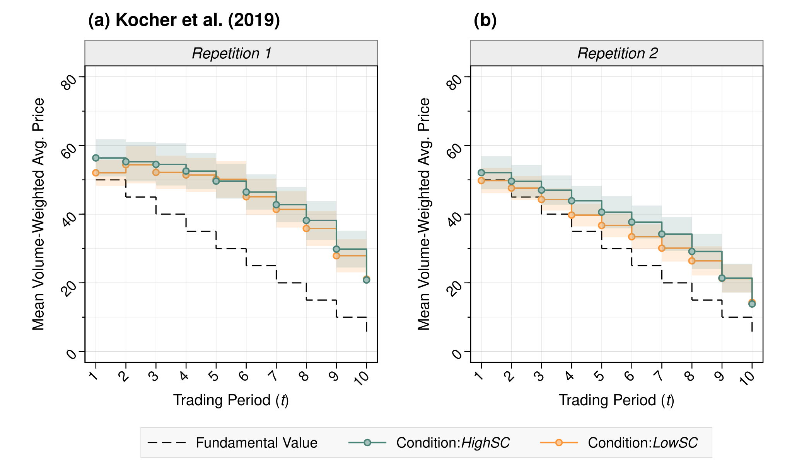{fig-align="center" height="440px"}

## Other Experiments I

#### Weitzel et al. (2020, Review of Financial Studies)

::: small
-   Experimental asset market over 20 periods of 120s

    -   8 traders per market

    -   Final buyback price of 28 Taler

    -   Dividend and interest payments<br> → Fundamental value of the asset is 28 at each point in time

::: fragment
-   4 Treatments:

    -   2 Bubble Drivers: INCreasing cash, HIGH cash (in relation to assets)

    -   2 Bubble Moderators: increasing cash with SHORT selling, LOW cash

    -   **Financial professionals (bankers) as participants**
:::
:::

## Other Experiments I {.weitzel}

#### Weitzel et al. (2020, Review of Financial Studies)

::: columns
::: {.column width="50%"}
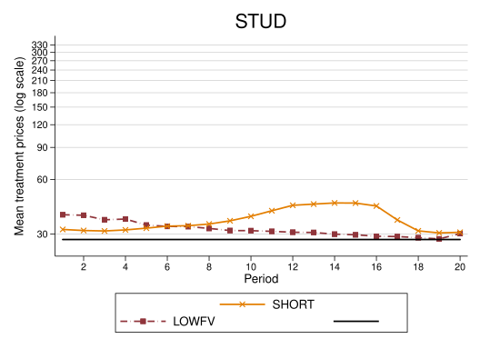{height="400px"}
:::

::: {.column width="50%"}
:::
:::

## Other Experiments I {.weitzel visibility="uncounted"}

#### Weitzel et al. (2020, Review of Financial Studies)

::: columns
::: {.column width="50%"}
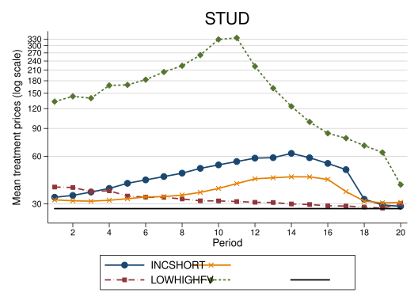{height="400px"}
:::

::: {.column .fragment width="50%"}
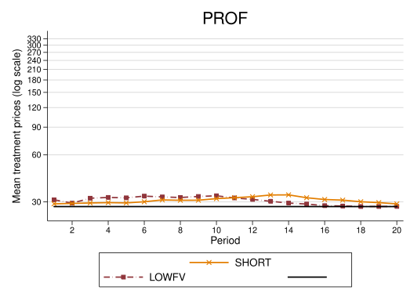{height="400px"}
:::
:::

## Other Experiments I {.weitzel visibility="uncounted"}

#### Weitzel et al. (2020, Review of Financial Studies)

::: columns
::: {.column width="50%"}
{height="400px"}
:::

::: {.column width="50%"}
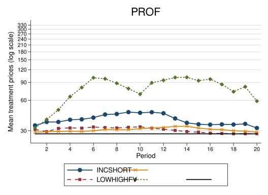{height="400px"}
:::
:::

::: {.fragment .small .weitzel-takeaway}
-   Bubble driver markets in PROF are significantly more efficient compared to student markets.
-   BUT: Similar treatment effects within the professional sample as with students.
:::

## Other Experiments II

#### Euphoria and Bubbles: Andrade et al. (2016, Review of Finance)

::: small
Hypothesis: Positive emotions lead to more "euphoric" pricing and hence to increased asset market bubbles. Conversely, if people feel depressed, lower bubbles should be observed.

-   Treatment **Excitement**: Subjects are shown a funny action movie of 5 minutes in advance.
-   Treatment **Calm**: Subjects are shown a video intended to incite calmness before trading.
:::

::: fragment
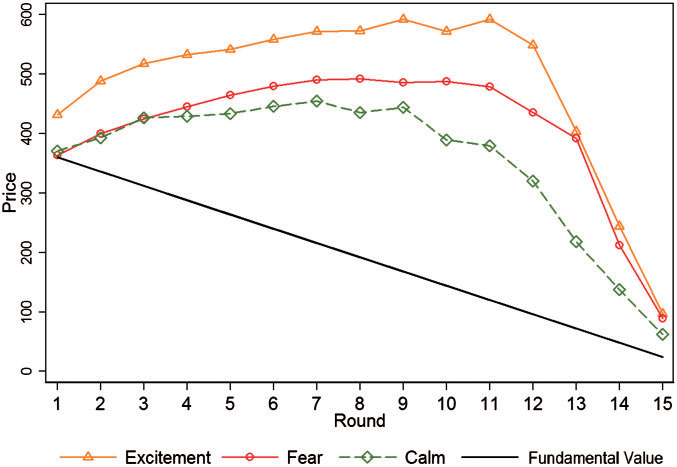{fig-align="center" height="250px"}
:::

## Other Experiments III

::: {.columns .small}
::: {.column width="50%"}
#### Inexperience: Dufwenberg et al. (2005, American Economic Review)

Markets are repeated three times with the same subjects; in the last repetition only one third of traders is experienced and the rest is inexperienced.

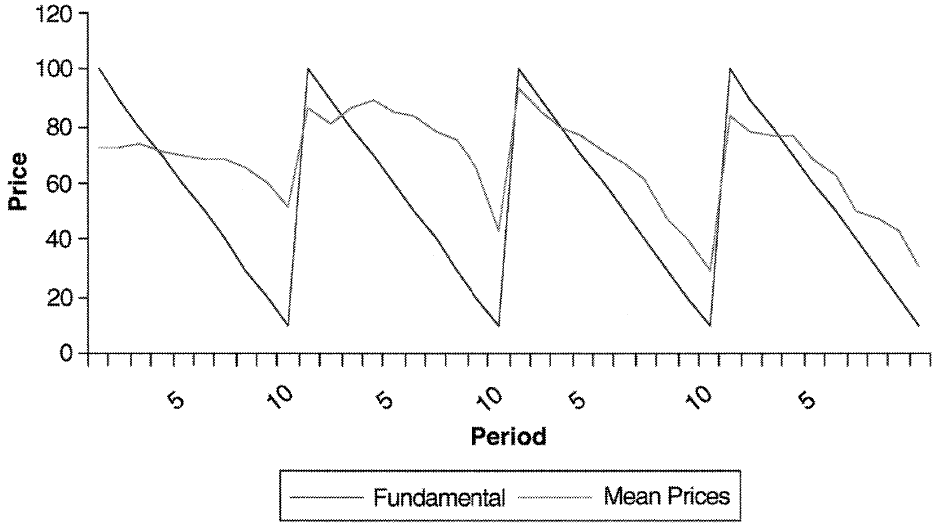{fig-align="center" height="230px"}

→ reduced bubbles with repetition
:::

::: {.column width="50%"}
#### Inflow of inexperienced traders: Kirchler et al. (2015, European Economic Review)

Every 3rd period 4 new traders enter with new cash up to period 8.

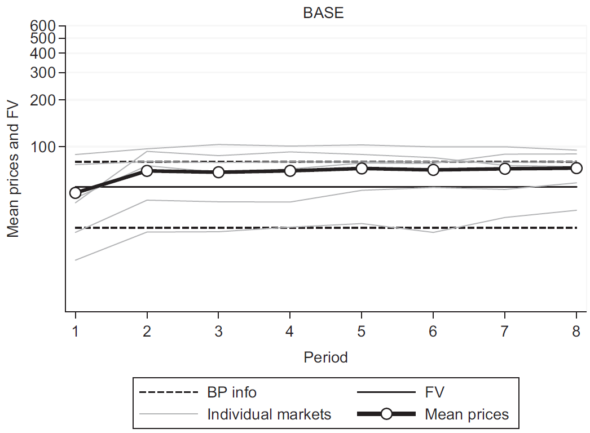{height="200px"} 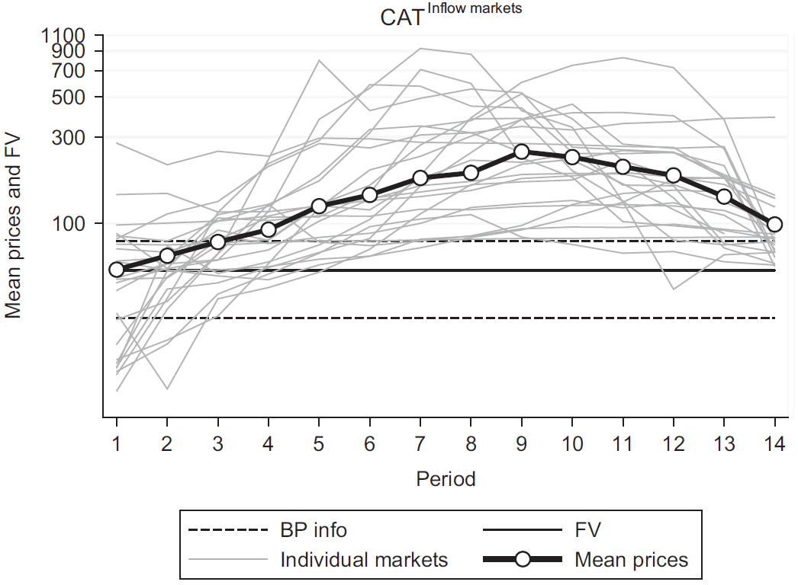{height="200px"}
:::
:::

## Other Experiments IV {visibility="hidden"}

#### Cognitive reflection: Bosch-Rosa et al. (2018, Experimental Economics)

Cognitive Reflection Test:

-   A bat and a ball cost \$1.10 in total. The bat costs \$1.00 more than the ball. How much does the ball cost?

-   If it takes 5 machines 5 minutes to make 5 widgets, how long would it take 100 machines to make 100 widgets?

-   In a lake, there is a patch of lily pads. Every day, the patch doubles in size. If it takes 48 days for the patch to cover the entire lake, how long would it take for the patch to cover half of the lake?

## Other Experiments IV {visibility="hidden"}

#### Cognitive reflection: Bosch-Rosa et al. (2018, Experimental Economics)

Participants grouped into HIGH and LOW cognitive reflection groups

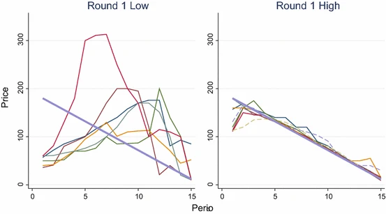{fig-align="center" height="400px"}

## Some Origins of Bubbles

::: {.columns .small}
::: {.column width="50%"}
-   Behavioral reasons:
    -   Euphoria (Andrade et al., 2016).
    -   Inexperience (Dufwenberg et al., 2005).
    -   Resale option theory (Harrison/Kreps, 1978; Ofek/Richardson, 2003).
    -   Confusion about fundamentals (Kirchler et al., 2012; Huber/Kirchler, 2012).
    -   Inflow of inexperienced traders (Kirchler et al., 2015).
    -   Asymmetric information bubbles (Allen et al., 1993).
    -   Limits of arbitrage (Abreu/Brunnermeier, 2002, 2003).
:::

::: {.column .fragment width="50%"}
-   Institutional reasons:
    -   Credit bubbles and positive liquidity shocks (Geanakoplos, 2010; Haruvy/Noussair, 2006; Weitzel et al., 2020).
    -   Agency problems/incentives (Allen/Gorton, 1993; Kleinlercher et al., 2014; Holmen et al., 2014).
    -   Prohibition of short selling (Haruvy/Noussair, 2006; Weitzel et al., 2020).
:::
:::

## {.center visibility="uncounted"}

[Skip to Experiment 2 →](#/exp2)

# From the Market to the Trader {.center background-color="#9BD84C"}

## From the market to the trader

::: columns
::: {.column width="45%"}
Why do people trade on a stock market?

::: fragment
-   Trade only happens when there are different expectations and opinions in a market.
-   If everyone has the same valuation, no one should trade.
:::
:::

::: {.column width="55%"}
::: fragment
What determines trading/investment decisions?
:::

::: fragment
-   **expectations** → part 1
-   **(risk) preferences** → part 2
:::

::: fragment
-   Behavioral factors
    -   heuristics and biases: e.g., framing effects, status quo bias, endowment effect, representativeness heuristic, availability heuristic, anchoring, ...
    -   overconfidence
    -   etc. ...
:::
:::
:::

## Prices reflect expectations

-   Assume the stock of Apple currently trades at 100 and the market expects an increase in the profit of 25%.

-   At a press conference the CEO proudly reveals *"We had a very good year and were able to increase the profit by 20%!"*

-   How will the stock price react?

. . .

→ Let's look at some real cases

::: notes
2026: moved to the start of the expectations block as the opening puzzle; Netflix and Alphabet are the real cases. The China/Germany growth example is now on the "Stock prices and expectations" slide.
:::

## Expectations: Netflix

::: columns
::: {.column width="55%"}
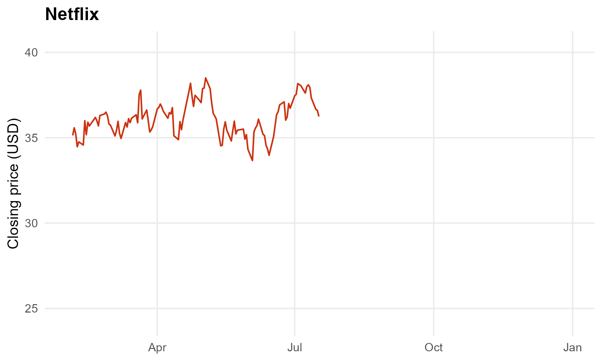{width="100%"}
:::

::: {.column .small width="45%"}
July 18, 2019:

-   *"The company added 2.7 million new subscribers in the second quarter of 2019, according to its latest earnings report released Wednesday."*

-   ...

-   *"Netflix now has 151.5 million subscribers globally."*
:::
:::

## Expectations: Netflix {visibility="uncounted"}

::: columns
::: {.column width="55%"}
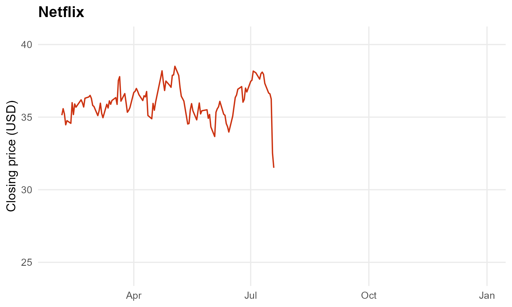{width="100%"}

→ **price dropped 10.3%!**
:::

::: {.column .small width="45%"}
July 18, 2019:

-   *"The company added 2.7 million new subscribers in the second quarter of 2019, according to its latest earnings report released Wednesday."*

-   *"That is just over half of 5 million new subscribers that analysts were expecting."*

-   *"Netflix now has 151.5 million subscribers globally."*
:::
:::

## Expectations: Netflix {visibility="uncounted"}

::: columns
::: {.column width="55%"}
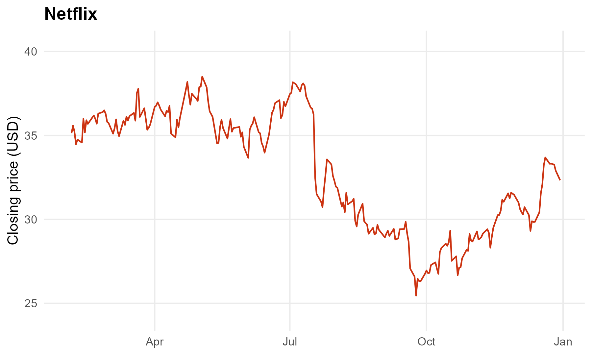{width="100%"}

→ **price dropped 10.3%!**
:::

::: {.column .small width="45%"}
July 18, 2019:

-   *"The company added 2.7 million new subscribers in the second quarter of 2019, according to its latest earnings report released Wednesday."*

-   *"That is just over half of 5 million new subscribers that analysts were expecting."*

-   *"Netflix now has 151.5 million subscribers globally."*
:::
:::

## Expectations: Netflix (again)

::: columns
::: {.column width="55%"}
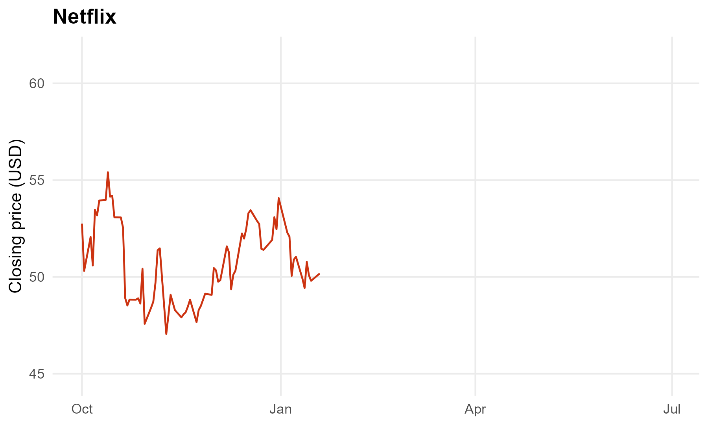{width="100%"}
:::

::: {.column .small width="45%"}
January 20, 2021:

-   *"The streaming service said it now has more than 200 million subscribers globally, after adding 8.5 million subscribers in the fourth quarter of 2020, ..."*
:::
:::

## Expectations: Netflix (again) {visibility="uncounted"}

::: columns
::: {.column width="55%"}
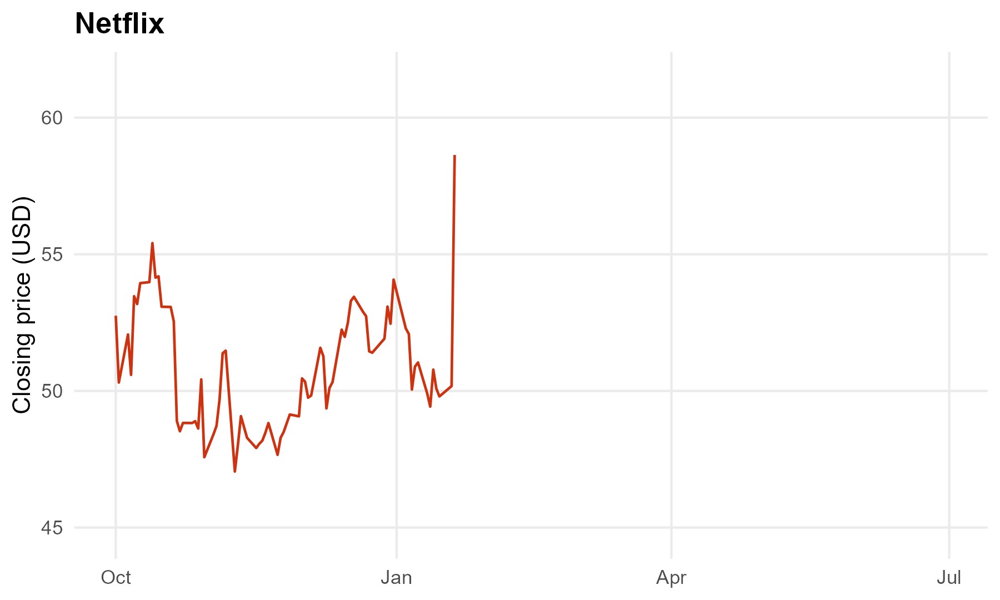{width="100%"}

→ **price increased 16.9%!**
:::

::: {.column .small width="45%"}
January 20, 2021:

-   *"The streaming service said it now has more than 200 million subscribers globally, after adding 8.5 million subscribers in the fourth quarter of 2020, ..."*

-   *"... beating its own expectations."*
:::
:::

## Expectations: Netflix (again) {visibility="uncounted"}

::: columns
::: {.column width="55%"}
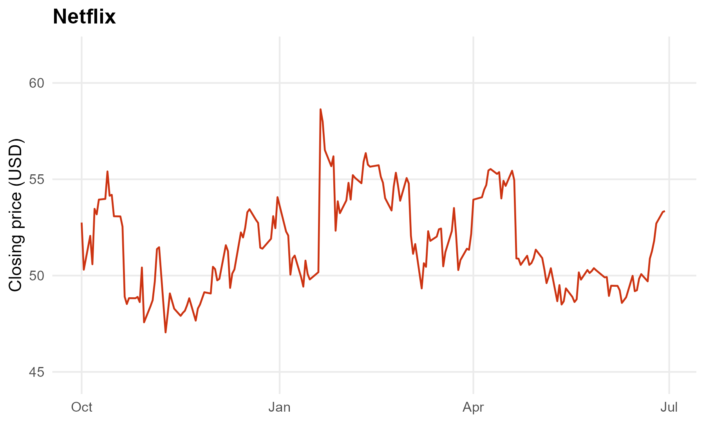{width="100%"}

→ **price increased 16.9%!**
:::

::: {.column .small width="45%"}
January 20, 2021:

-   *"The streaming service said it now has more than 200 million subscribers globally, after adding 8.5 million subscribers in the fourth quarter of 2020, ..."*

-   *"... beating its own expectations."*
:::
:::

## Expectations: Alphabet

::: columns
::: {.column width="55%"}
::: r-stack
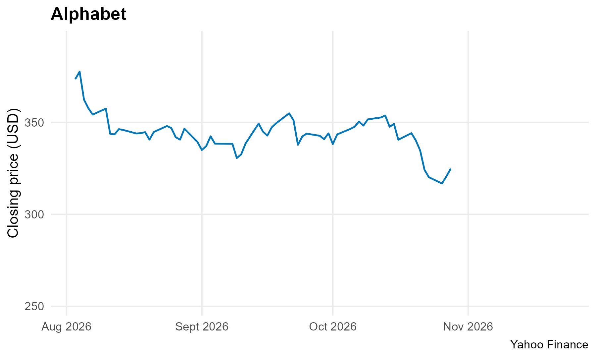{width="100%"}

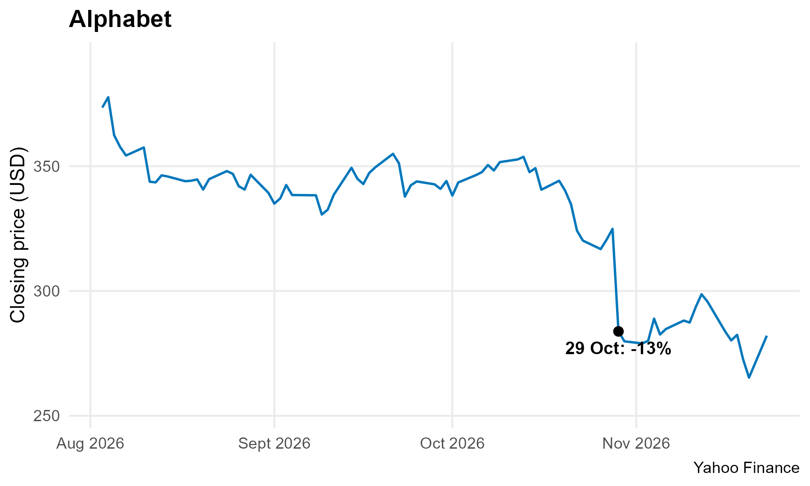{.fragment fragment-index="2" width="100%"}
:::
:::

::: {.column .small width="45%"}
Q3 results, 28 Oct 2026 (after the close):

-   Revenue **+25%** to \$127.6bn, but slightly below analysts' forecasts
-   Search ads +12% (\$63.4bn vs. \$64.9bn expected): "AI mode" answers eat into classic search
-   Net profit \$26.2bn vs. \$37.3bn expected

::: {.fragment fragment-index="1"}
-   AI spending of \$51bn in one quarter → cash flow negative (−\$9.1bn)
:::

::: {.fragment fragment-index="2"}
→ **shares −13%** on 29 Oct, about **\$500bn** of market value in one day
:::

::: ref-line
Financial Times, 28 Oct 2026
:::
:::
:::

::: notes
Replaces the Meta (April 2024) example in 2026. Same lesson as the Apple and Netflix slides: revenue grew 25%, but less than expected, so the price fell. The −13% is our Yahoo close-to-close (324.89 → 283.82); the FT reports "13 per cent" and ~$500bn, the second-largest one-day loss of market value after Nvidia in Jan 2025. Profit miss is partly an $8.7bn loss on the SpaceX stake and a $5.2bn EU fine payment; operating income was $40.6bn vs. $43.2bn expected. Contrast: Microsoft reported the same day, also heavy capex but strong cash flow, and its shares were flat (−0.2%). Links to the Minsky slide (AI capex financed with debt and a share sale; >$1tn in commitments).
:::

## Expectations: Meta {visibility="hidden"}

::: columns
::: {.column width="55%"}
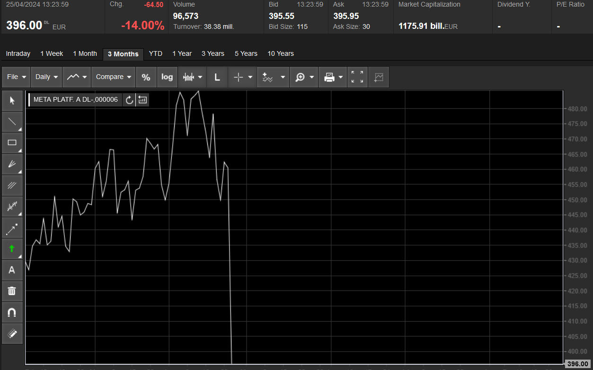{width="100%"}

→ **price dropped 14%!** (as of 13:24)
:::

::: {.column .small width="45%"}
April 24/25, 2024:

-   *"Meta Platforms (META) reported first quarter earnings of \$4.71 per share, well above analyst estimates of \$4.30. Revenue was about in line with expectations, \$36.46 billion compared to the \$36.12 billion estimate."*

::: fragment
-   *"For the second quarter, the social media giant sees revenue of \$36.5 billion to \$39 billion. Analysts were expecting \$38.24 billion of revenue in the quarter, which means the midpoint of the range is a disappointment to the Street."*

(announced at 4:05pm, 5 minutes after NYSE closed)
:::
:::
:::

## Stock prices and expectations

::: columns
::: {.column .small width="45%"}
-   The announcement *"China's economy grows by 3%"* would likely lead to a market crash. The message *"Germany's economy grows by 3%"* to a positive price jump.

-   2009–2019 the Chinese economy grew by a cumulative +180%, the German economy grew by only +14%.

::: {.fragment fragment-index="2"}
-   However, the Chinese stock index did not grow as much as the German DAX index.
-   The market is more complex than most people think; **expectations are already priced in**.
:::
:::

::: {.column .fragment fragment-index="2" width="55%"}
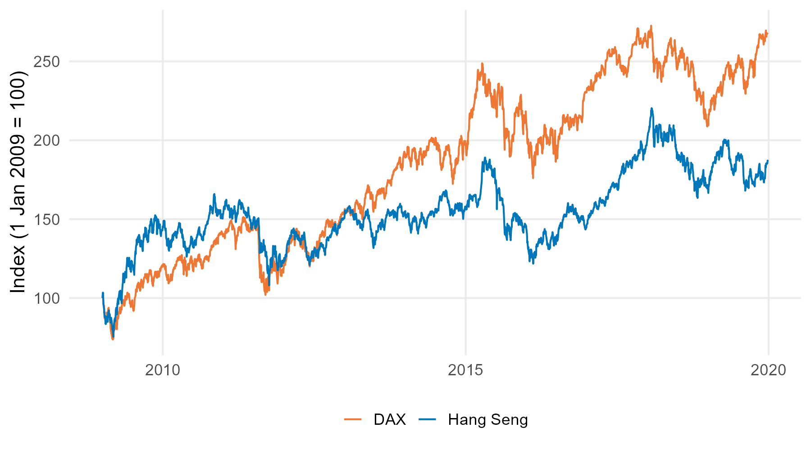{height="390px"}
:::
:::

## Already priced in are, for example, ... {visibility="hidden"}

-   China's continuing rise

-   Europe's ageing society

-   Instability in the Middle East

-   Apple's consistent iPhone sales

-   U.S. Fed's possible interest rate hikes

-   etc.

## Efficient vs. Inefficient Markets

::: columns
::: {.column width="40%"}
{height="150px"}

::: small
**Eugene Fama** (1970), Nobel Laureate 2013

*"a market is efficient, if prices at all times fully reflect all available information"*
:::
:::

::: {.column .fragment width="60%"}
{height="150px"}

::: small
**Robert Shiller**, Nobel Laureate 2013

"In the 1960s, Eugene Fama demonstrated that stock price movements are impossible to predict in the short-term. In the early 1980s, however, Robert Shiller discovered that *stock prices can be predicted* over a longer period, such as over the course of several years. In contrast to the dominant perception, stock prices fluctuated much more than corporate dividends. Shiller's conclusion was therefore that *the market is inefficient*." (from [NobelPrize.org](https://www.nobelprize.org/prizes/economic-sciences/2013/shiller/facts/))
:::
:::
:::

::: {.fragment .small}
→ Why do prices swing more than dividends? Does **risk-taking change over the market cycle**?
:::

::: notes
Fama and Shiller shared the 2013 prize (with Lars Peter Hansen). EMH: $E(P_{t+1}) = P_t + E(R)$. Shiller (1981, AER) is the "excess volatility" paper behind the quote. Background if asked: Campbell & Cochrane (1999, JPE, "By Force of Habit") explain excess volatility with risk aversion that falls in booms and rises in busts. Cohn et al. (2015, AER) test this with professionals (later slide), and Experiment 2 asks the same question. The two separate 2025 slides are kept below as hidden slides.
:::

## Efficient Market Hypothesis (EMH) {visibility="hidden"}

::: columns
::: {.column width="55%"}
Eugene Fama (1970)<br> (Nobel Laureate 2013)

*"a market is efficient, if prices at all times fully reflect all available information"*
:::

::: {.column .tc width="45%"}
{height="420px"}
:::
:::

::: notes
$E(P_{t+1}) = P_t + E(R)$
:::

## Inefficient Markets {visibility="hidden"}

::: columns
::: {.column .tc width="40%"}
{height="360px"}
:::

::: {.column .smaller width="60%"}
Robert Shiller<br> (Nobel Laureate 2013)

"In the 1960s, Eugene Fama demonstrated that stock price movements are impossible to predict in the short-term. In the early 1980s, however, Robert Shiller discovered that *stock prices can be predicted* over a longer period, such as over the course of several years. In contrast to the dominant perception, stock prices fluctuated much more than corporate dividends. Shiller's conclusion was therefore that *the market is inefficient*." (from [NobelPrize.org](https://www.nobelprize.org/prizes/economic-sciences/2013/shiller/facts/))
:::
:::


## Risk Preferences: Experiment 2 {#exp2}

#### Huber et al. (2020, 2021)

**Research Question:** How does *risk-taking behavior* and the *perception of risk* change during/after a market shock?

-   Investment task: **1 risky stock** over *5 rounds*

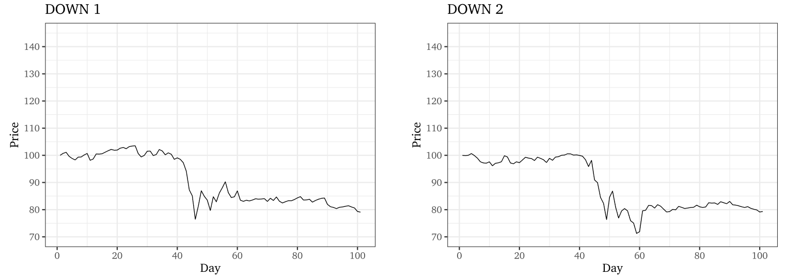{fig-align="center" height="285px"}

## Risk Preferences: Experiment 2

#### Your data

::: columns
::: {.column width="72%"}
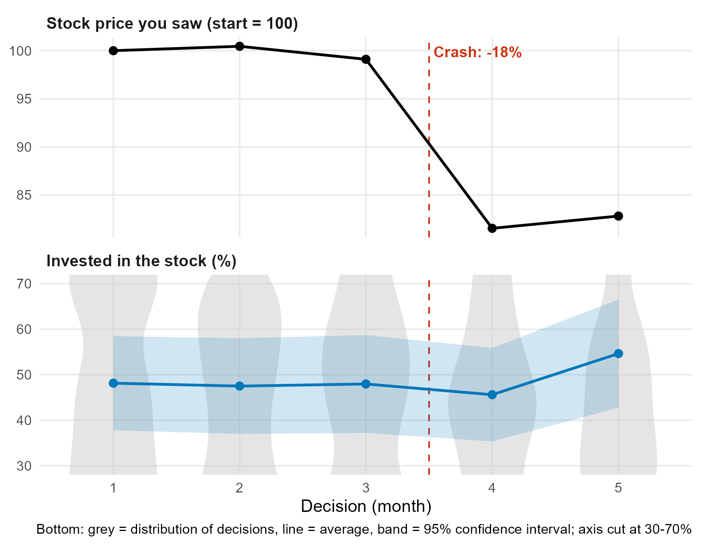{height="470px"}
:::

::: {.column width="28%"}
<br><br> → more risk-taking after crash

Why?

Belief in mean-reversion?
:::
:::

## Risk Preferences: Experiment 2

#### Your earnings



## Risk Preferences: Experiment 2

#### Huber et al. (2020, 2021)

::: small
-   Investment task: **1 risky stock** over *5 rounds*
-   Two waves: Wave 1 in December 2019; Wave 2 in April 2020 (during the Covid-19 crash)
:::

::: columns
::: {.column .tc width="50%"}
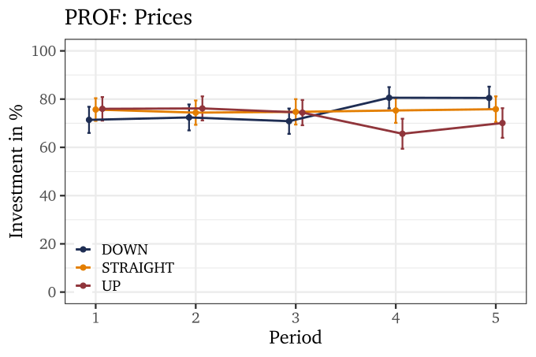{height="245px"}
:::

::: {.column .tc width="50%"}
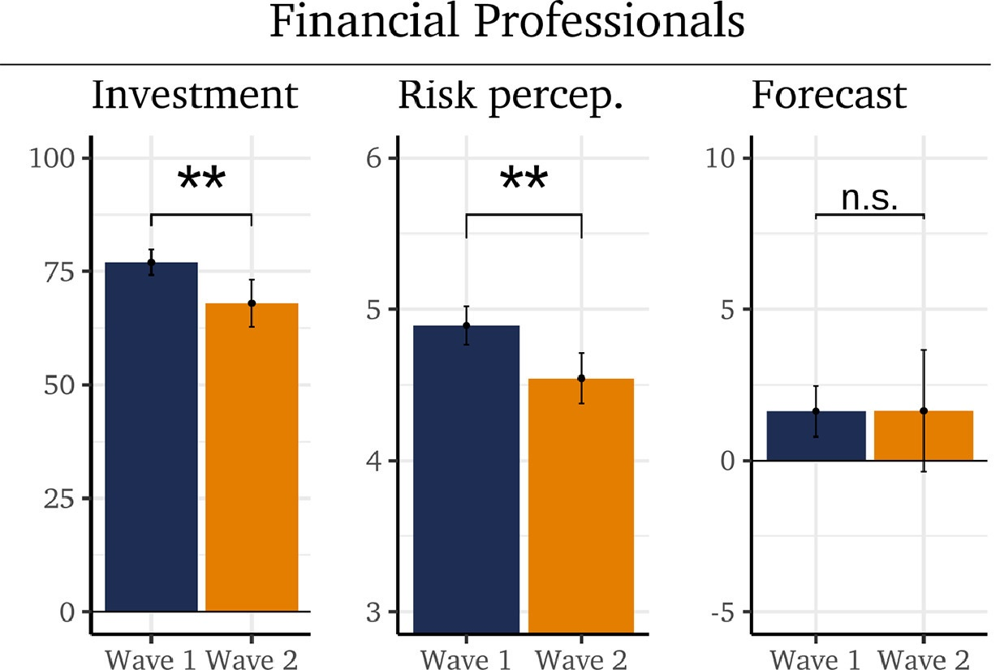{height="245px"}
:::
:::

→ countercyclical risk aversion?

## Risk Preferences: Another Experiment

#### Cohn et al. (2015, American Economic Review): Evidence for countercyclical risk aversion

Participants are *primed* with a boom or with a bust scenario (simulation)

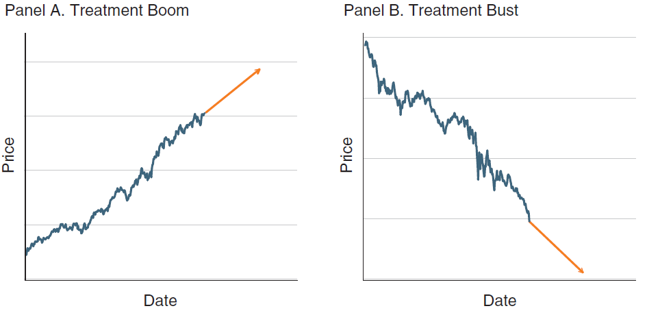{fig-align="center" height="400px"}

## Risk Preferences: Another Experiment

#### Cohn et al. (2015, American Economic Review): Evidence for countercyclical risk aversion

Countercyclical risk aversion: more risk-taking in a boom

::: columns
::: {.column width="50%"}
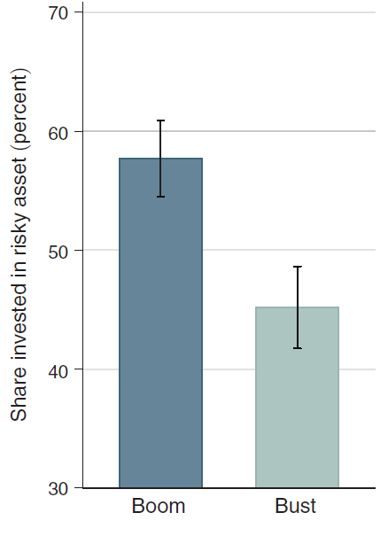{fig-align="center" height="395px"}
:::

::: {.column .fragment width="50%"}
→ driven by emotions

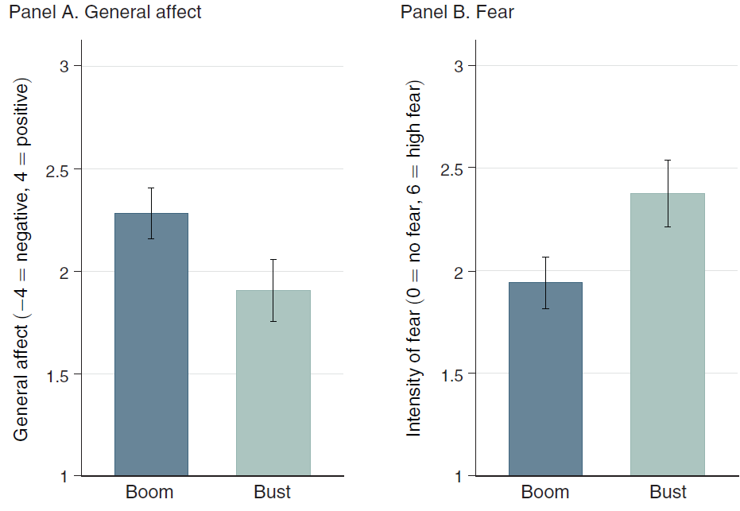{height="310px"}
:::
:::

# Recap and a Look at Recent Bubbles {.center background-color="#9BD84C"}

## Bubbles and crashes in financial markets

::: columns
::: {.column width="55%"}
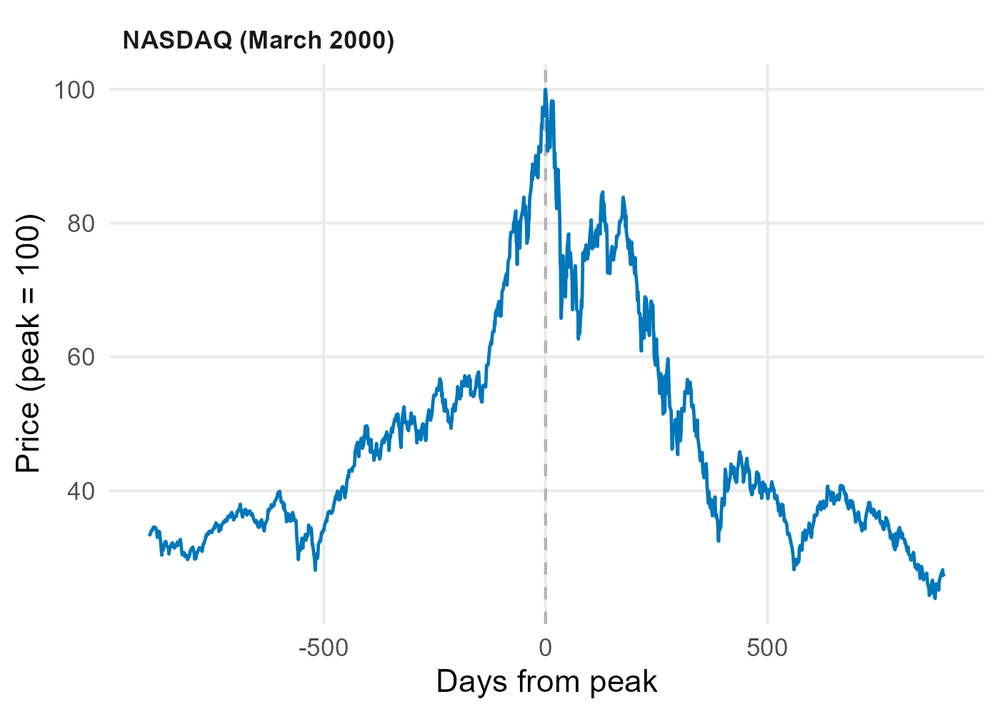{height="450px"}
:::

::: {.column .recap-text .fragment width="45%"}
#### Dot-com bubble

-   revolution in information technologies (Internet)
-   sharp declines in costs of communication

→ **a new product / new world**

-   a decline in interest rates
-   lowered capital gains tax

→ **cheap money, lots of liquidity, leverage**

Also:

-   pro-cyclical credit supply
-   counter-cyclical risk aversion
-   fraud
:::
:::

## Bubbles and crashes in financial markets

::: columns
::: {.column width="45%"}
#### Bitcoin / Tesla
:::

::: {.column width="55%"}
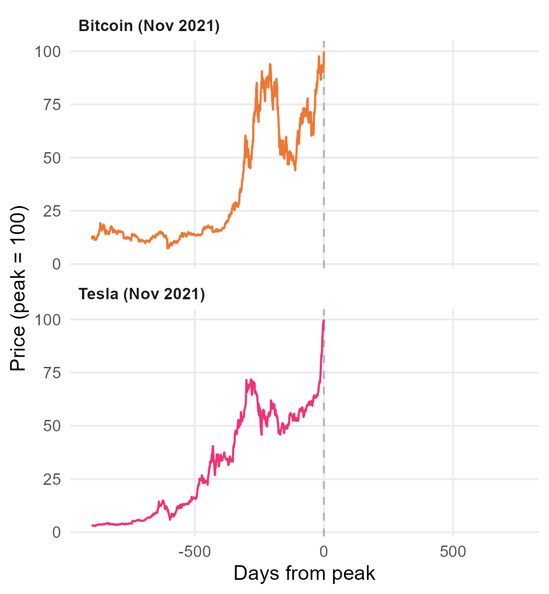{height="500px"}
:::
:::

## Bubbles and crashes in financial markets {visibility="uncounted"}

::: columns
::: {.column width="45%"}
#### Bitcoin / Tesla

::: {.fragment .recap-text}
→ **a new product / new world**?

→ **cheap money, lots of liquidity, leverage**?
:::
:::

::: {.column width="55%"}
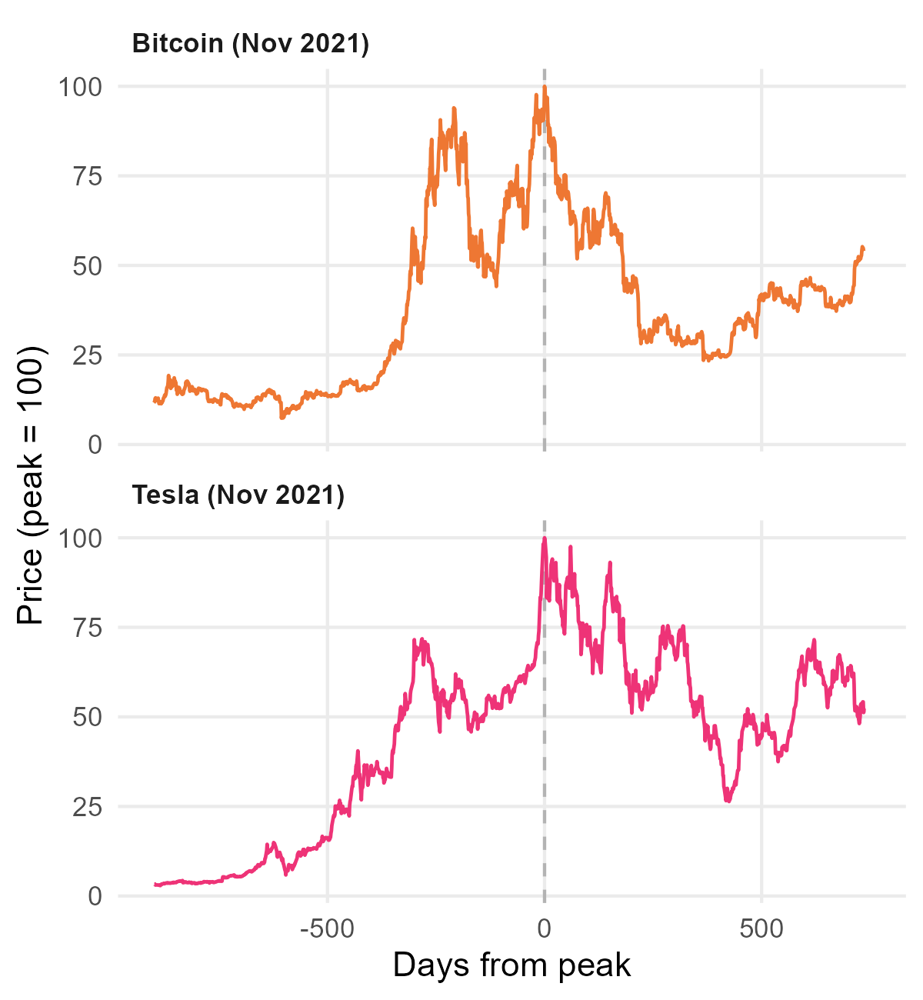{height="500px"}
:::
:::

## Bubbles and crashes in financial markets

::: columns
::: {.column width="45%"}
#### Zoom / Moderna

::: recap-text
→ **a new product / new world**?

→ **cheap money, lots of liquidity, leverage**?
:::
:::

::: {.column width="55%"}
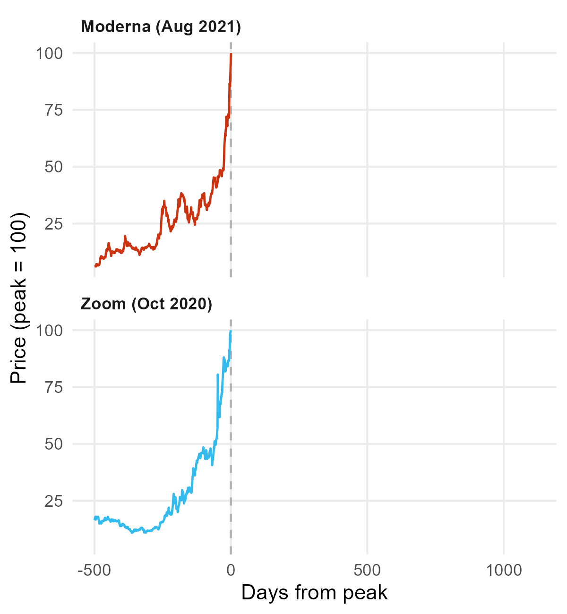{height="500px"}
:::
:::

## Bubbles and crashes in financial markets {visibility="uncounted"}

::: columns
::: {.column width="45%"}
#### Zoom / Moderna

::: recap-text
→ **a new product / new world**?

→ **cheap money, lots of liquidity, leverage**?
:::
:::

::: {.column width="55%"}
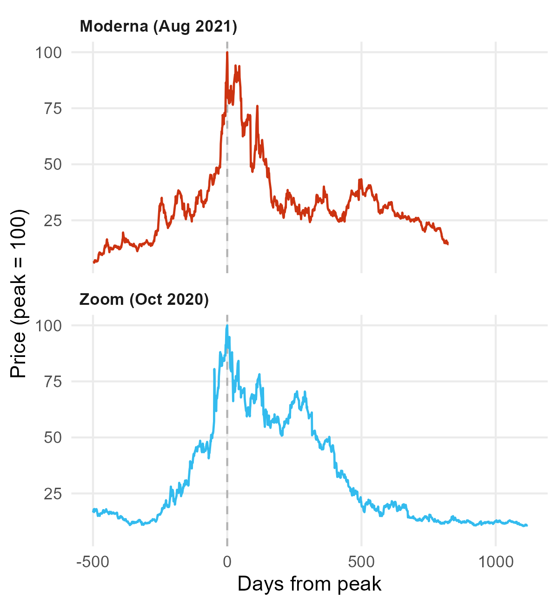{height="500px"}
:::
:::

## Bubbles and crashes in financial markets {visibility="uncounted"}

::: columns
::: {.column width="45%"}
#### Zoom / Moderna

::: recap-text
→ **a new product / new world**?

→ **cheap money, lots of liquidity, leverage**?
:::
:::

::: {.column width="55%"}
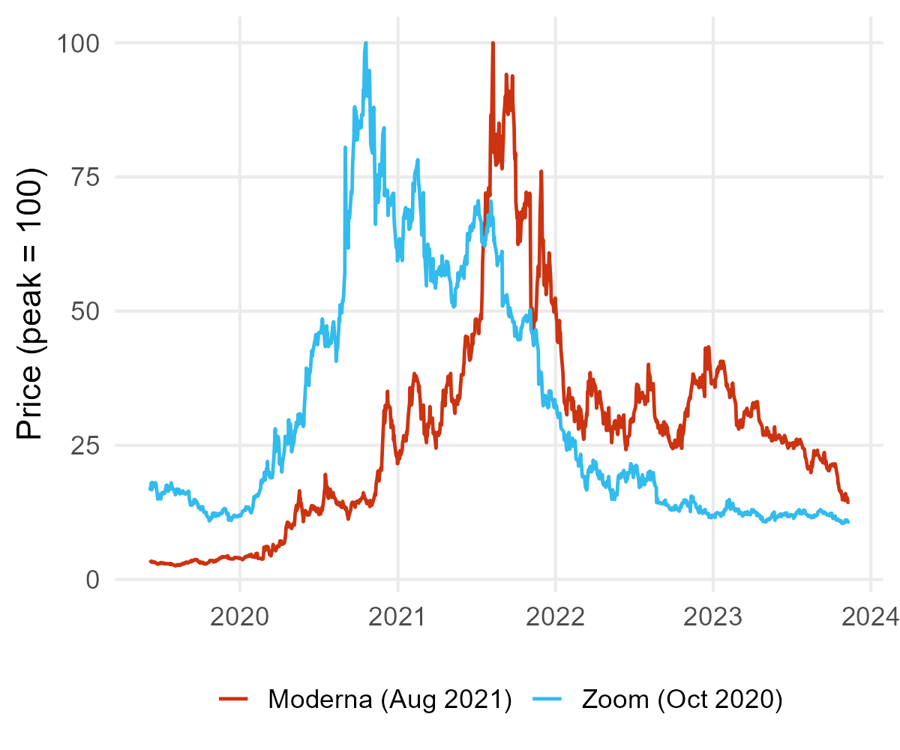{height="460px"}
:::
:::

## Bubbles and crashes in financial markets

::: columns
::: {.column width="35%"}
#### Nvidia

::: recap-text
→ **a new product / new world**?

→ **cheap money, lots of liquidity, leverage**?
:::
:::

::: {.column width="65%"}
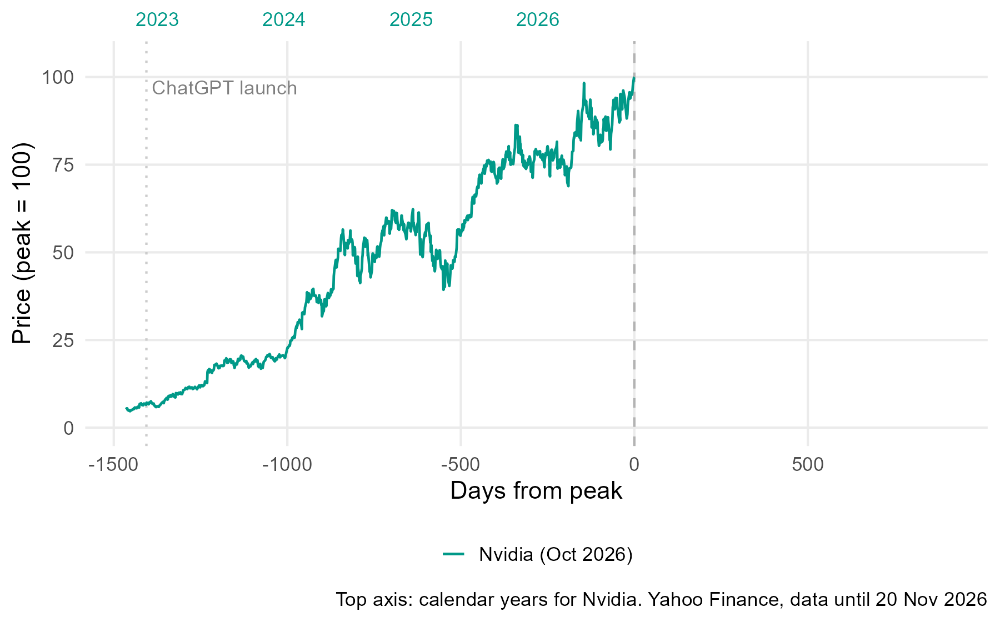{width="100%"}
:::
:::

## Bubbles and crashes in financial markets {visibility="uncounted"}

::: columns
::: {.column width="35%"}
#### Nvidia

::: recap-text
→ **a new product / new world**?

→ **cheap money, lots of liquidity, leverage**?
:::
:::

::: {.column width="65%"}
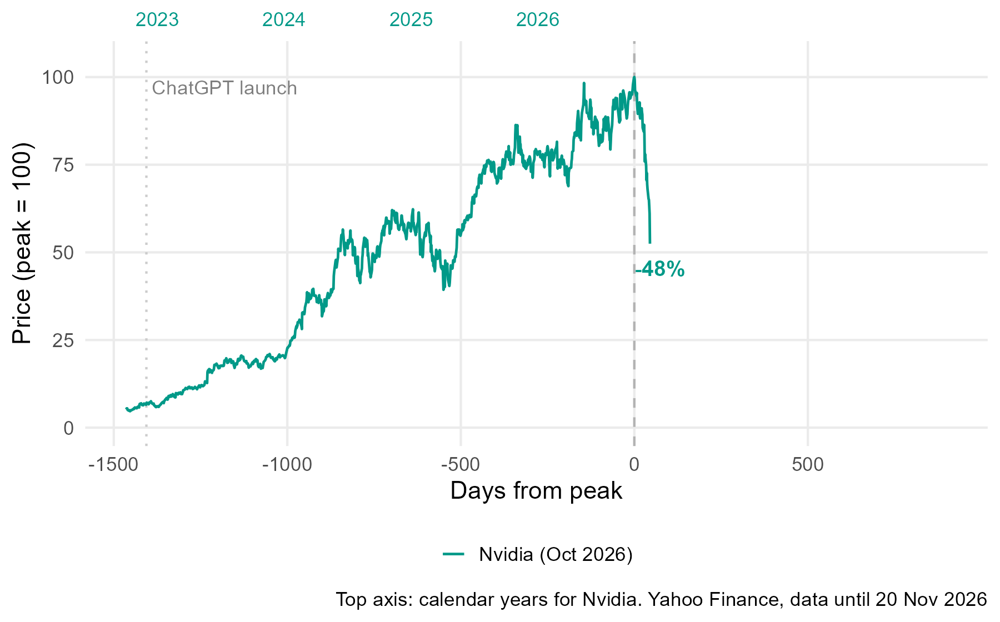{width="100%"}
:::
:::

## Bubbles and crashes in financial markets {visibility="uncounted"}

::: columns
::: {.column width="35%"}
#### Nvidia vs. the dot-com bubble

::: recap-text
→ **a new product / new world**?

→ **cheap money, lots of liquidity, leverage**?

::: fragment
→ "this time is different"?
:::
:::
:::

::: {.column width="65%"}
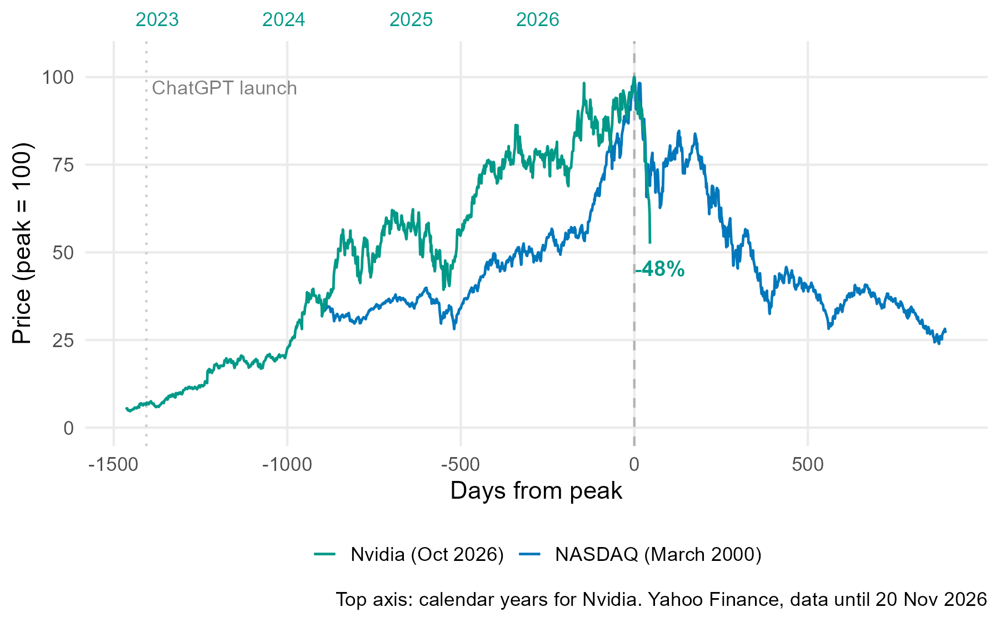{width="100%"}
:::
:::

::: notes
Point at the NASDAQ line after day 0: the dot-com bust came in stages (first drop, a rebound, then the big fall). Krugman (23 Nov 2026) makes the same point: the AI fall so far is still much smaller than the NASDAQ's roughly 70%.
:::

## Nvidia: the last weeks

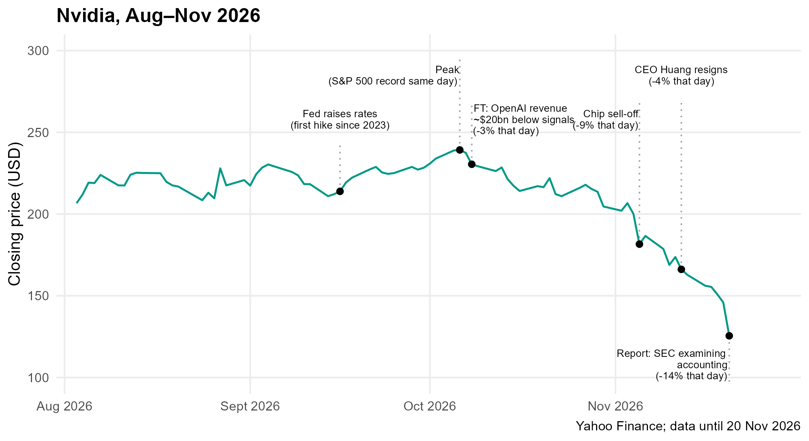{fig-align="center" height="500px"}

::: notes
Event dates checked on 23 Nov 2026: Fed FOMC statement (16 Sep); FT report on OpenAI's revenue, confirmed by Reuters (8 Oct); chip-stock sell-off (5 Nov); Nvidia press release on the CEO transition (12 Nov); Reuters report that SEC staff are examining possible accounting issues (20 Nov). The SEC examination is a press report, not a finding of wrongdoing. Update the chart before class: Rscript R/market_figures.R --refresh-NVDA (and edit the event list in section 6 of the script if something new happens).
:::

## Nvidia: the last weeks {visibility="uncounted"}

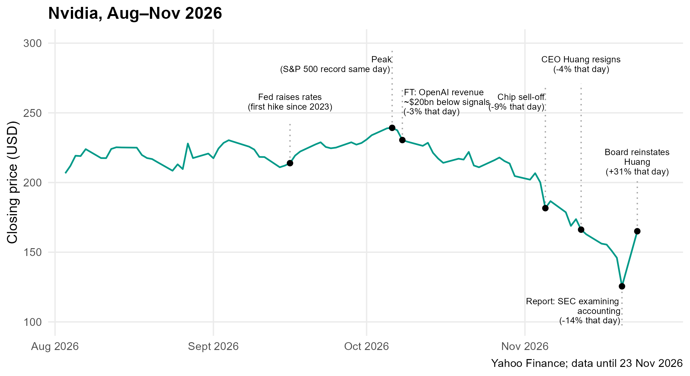{fig-align="center" height="500px"}

::: notes
Same axes as the previous slide; only the 23 Nov close is added. Let the jump sink in before saying what happened: the board reinstated Huang (23 Nov). Close 165.05 vs 125.53 on 20 Nov, +31.5%. Still well below the October peak (~240).
:::

## Nvidia: CEO reinstated

::: {.incremental .small}
-   **12 Nov:** Jensen Huang resigns; CFO Colette Kress becomes interim CEO

-   **17 Nov:** Board says it does *not* intend to bring him back

-   **23 Nov:** Board reinstates Huang as CEO and president; Trump calls him a "Great Patriot and National Treasure"

-   **Market reaction (23 Nov):** Nvidia **+31.5%** (\~\$1 trillion of market value in a day); Nasdaq +6.5%, S&P 500 +4.7%
:::

. . .

::: small
→ Can **one person** be worth \~\$1 trillion? Key-person risk, sentiment, or fundamentals?

→ A turning point, or a "counter-trend rally"? The dot-com bust also came in stages (see the NASDAQ line)
:::

::: notes
Sources: CNBC and Yahoo Finance, 23 Nov 2026. Nvidia change is the 23 Nov close from our Yahoo download (165.05 vs 125.53, +31.5%; the Yahoo page widget showed 165.13, +31.55%); index changes as shown by Yahoo Finance; "nearly $1 trillion" is Yahoo's wording. Yahoo contradicts itself on "best day since May 2003" vs "May 2023", so that claim is left out. "Counter-trend rally" is Jay Woods (Freedom Capital), quoted by CNBC; strategists are split. Trump also reportedly said he "made the deal" (headline only, not checked). The reported SEC examination (20 Nov) is not addressed in these sources; check its status before class. Discussion hook: a 31% jump on news about one person, with no change in chip demand, is hard to square with the EMH slide, unless investors thought Huang alone was worth that much in expected cash flows.
:::

## 2026 through Minsky's lens

::: {.incremental .small}
-   **Displacement / new world:** ChatGPT (Nov 2022), AI as the new general-purpose technology

-   **Credit and vendor finance:** "circular" deals: Nvidia invests in OpenAI, OpenAI buys Nvidia chips (similar ties with Microsoft, Amazon, Oracle)

-   **Euphoria and leverage:** record US margin debt (\~\$1.5 trillion, June 2026), heavy retail trading

-   **Cheap money ends:** Fed raises rates on 16 Sep 2026, the first hike since 2023

-   **Expectations revised:** 8 Oct: report that OpenAI's revenue is \~\$20bn below what investors were told

-   **Distress:** 12 Nov: CEO resigns; 20 Nov: reported SEC examination of Nvidia's accounting; 23 Nov: CEO reinstated, +31%
:::

. . .

→ A textbook bubble, or a correction in a sound boom? Ask again in a year!

::: notes
Maps the current episode onto the Minsky slides from the first part. Vendor finance: compare Lucent/Cisco financing their customers in 1999-2000. Margin-debt figure: FINRA data as reported in Nov 2026 (record ~$1.50tn in June, ~$1.45tn in October). The SEC examination is reported, not a finding of wrongdoing. Recheck all of this the day before the lecture.
:::

## Is it a bubble?

::: ref-line
Krugman, P. (23 Nov 2026). Pop! Goes the bubble. *Substack*.
:::

::: columns
::: {.column width="58%"}
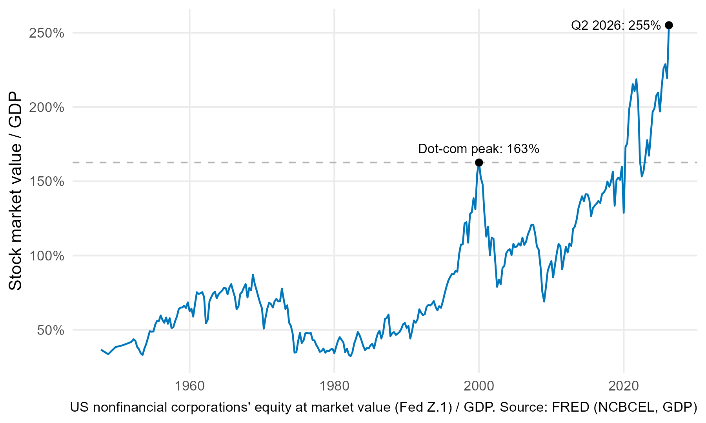{height="400px"}
:::

::: {.column .small width="42%"}
-   Stock market value relative to GDP far above the dot-com peak

-   Productivity growth so far only slightly above its 20-year average

-   Competition (e.g., cheap open-weight models) makes lasting monopoly profits doubtful

::: fragment
→ "Future Microsofts" or "future WorldComs"?
:::
:::
:::

::: notes
Chart is our own (FRED: NCBCEL / GDP, data to Q2 2026, i.e. before the October peak); Krugman shows a similar measure. Ties back to the definition slide: we cannot observe the fundamental value, so he asks whether productivity or profits could justify the prices. His estimate: returning to 2019 valuations would wipe out about $25 trillion, roughly 80% of GDP. He does not discuss the Fed, leverage or circular deals; those are on the Minsky slide.
:::

## Takeaways

::: columns
::: {.column .small width="60%"}
**Lab evidence from today**

::: incremental
-   More cash and credit relative to assets → larger bubbles <br>(Weitzel et al., 2020)

-   Short selling dampens bubbles <br>→ think twice about short-selling bans in a crisis

-   Experience reduces bubbles, but inflows of new, inexperienced investors bring them back <br>(Dufwenberg et al., 2005; Kirchler et al., 2015)

-   Emotions and recent crashes change risk-taking <br>(Andrade et al., 2016; Cohn et al., 2015; your Experiment 2)

-   Professionals are not immune <br>(Weitzel et al., 2020)
:::
:::

::: {.column .small width="40%"}
::: fragment
**Discussion**

-   "This time is different": why are authorities so often convinced?

-   Is Nvidia / AI a bubble? How would you know *before* the crash?

-   What could an authority actually do about it?
:::
:::
:::

::: notes
Optional slide (new in 2026). Each bullet links back to an earlier slide: Weitzel et al. (cash, short selling, professionals), Dufwenberg/Kirchler (experience, inflows), Andrade/Cohn and Experiment 2 (emotions, countercyclical risk aversion). Use the right column as an open discussion with the participants, who mostly work at central banks and ministries.
:::

## Further Reading

-   John K. Galbraith: *A Short History of Financial Euphoria*

-   Robert Z. Aliber and Charles P. Kindleberger: *Manias, Panics, and Crashes*

-   Robert J. Shiller: *Irrational Exuberance*

# Thanks {visibility="hidden"}

##  {.center background-color="#9BD84C" background-image="material/picture_aalto_2_crop1.jpg" background-size="cover" state="is-thanks" visibility="uncounted"}

::: columns
::: {.column width="47%"}
:::

::: {.column width="53%"}
<h2 class="thanks">

Thanks

</h2>

::: {style="border: none; border-top: 5px solid black; width: 100px; height: 1cm; text-align: left; margin: 0;"}
:::

<p class="thanks">

christoph.huber\@aalto.fi

</p>

<p class="thanks">

chr-huber.com

</p>

<p class="thanks">

{fig-align="left" width="250"}

</p>
:::
:::

::: footer
:::
